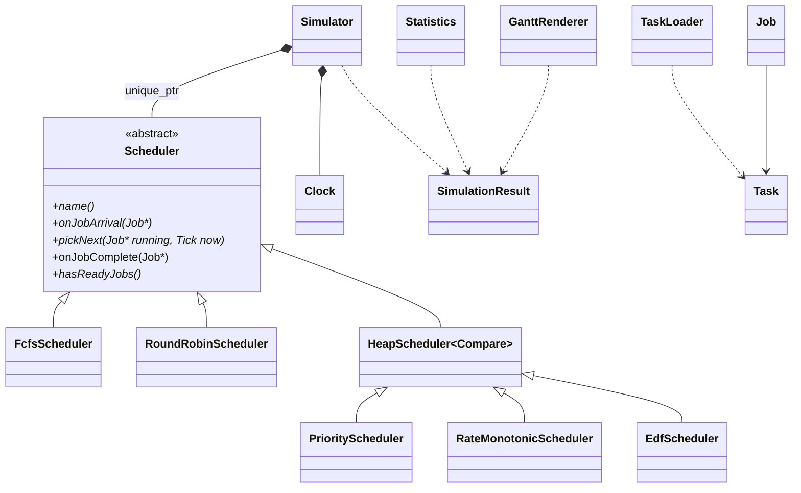

# RTOS Task Scheduler Simulator

A command-line simulator, in modern C++17, of how a real-time operating system
schedules tasks on a single-core CPU. It runs the same task set through
**FCFS, Round Robin, Preemptive Priority, Rate Monotonic and EDF**, draws an
ASCII Gantt chart, computes per-task and overall statistics, and checks
schedulability with the Liu & Layland bound (RM) and U ≤ 1 (EDF).

Key data structures are written by hand: a templated binary **min-heap**
(ready queue for Priority/RM/EDF and the simulation event queue) and a
**circular queue** (Round Robin). Full design notes: [docs/DESIGN.md](docs/DESIGN.md).

## Build

Requires CMake ≥ 3.16 and a C++17 compiler (GCC ≥ 9, Clang ≥ 10 or MSVC 2019+).
GoogleTest is downloaded automatically.

```bash
cmake -S . -B build -G "MinGW Makefiles"   # drop -G on Linux/macOS
cmake --build build
ctest --test-dir build --output-on-failure
```

**Windows note:** WinLibs ships its own `cmake.exe` built with GnuTLS. That build
has no CA certificates, so FetchContent fails with "SSL peer certificate ... not OK".
Put Kitware's CMake (`C:\Program Files\CMake\bin`) ahead of WinLibs on `PATH` so
it uses the Windows certificate store.

## Usage

```
rtos_sim <tasks.csv> [--algo fcfs|rr|priority|rm|edf|all] [--quantum N] [--horizon N]
```

- `--algo all` (default) runs every scheduler and prints a comparison table.
- `--quantum` is the Round Robin time slice (default 2).
- `--horizon` defaults to one hyperperiod after the last arrival (periodic sets),
  or until every job finishes (aperiodic sets).

Task file format (`period 0` = aperiodic, `deadline 0` = use the period):

```
id,name,arrival,burst,priority,period,deadline
1,FastLoop,0,2,1,5,0
2,SlowLoop,0,4,2,7,0
```

Example: `rtos_sim data/rm_vs_edf.csv --algo rm`

```
Schedulability (2 periodic tasks)
  U = 0.971
  RM : U <= 0.828 (Liu & Layland)? no, inconclusive (simulate to check)
  EDF: U <= 1? yes

=== RM ===
time      0    5    10   15   20   25   30
          |----|----|----|----|----|----|----
FastLoop  ##...##...##...##...##...##...##...
SlowLoop  ..###..###..###..###..###..###..##.

task            jobs  done  wait    tat     resp    missed
FastLoop        7     7     0.00    2.00    0.00    0
SlowLoop        5     5     2.80    6.80    0.80    1
```

SlowLoop's first job needs ticks 2, 3, 4 and 7, so it finishes at 8, after its
deadline of 7. Run the same file with `--algo edf` and every deadline is met.

Comparison mode on `data/aperiodic.csv`:

```
algo      wait    tat     resp    misses  switches  util%   done
FCFS      4.75    8.50    4.75    0       3         100.00  4
RR(q=2)   5.75    9.50    1.75    0       7         100.00  4
Priority  3.75    7.50    2.25    0       4         100.00  4
```

Round Robin has the best response time but the most context switches; that is
the classic trade-off.

## Class diagram



`Simulator` decides **when** (releases, ticks, completions); the `Scheduler`
strategy decides **who** runs. Adding a new algorithm is one new subclass and
one line in the factory, with no change to the simulator (open/closed).

## Algorithms

| Algorithm | Rule | Preemptive | Ready queue |
|-----------|------|------------|-------------|
| FCFS | Run in arrival order until done | No | `std::queue` |
| Round Robin | Each job gets `q` ticks, then goes to the back | Yes (on quantum expiry) | `CircularQueue` (ours) |
| Priority | Lowest priority number wins | Yes | `MinHeap` by priority |
| Rate Monotonic | Shortest period wins (fixed priority) | Yes | `MinHeap` by period |
| EDF | Earliest absolute deadline wins (dynamic) | Yes | `MinHeap` by deadline |

Ties are broken by release time, then task id, so runs are deterministic.

## Complexity (n = ready jobs, H = ticks simulated, J = jobs released)

| Operation | FCFS | RR | Priority / RM / EDF |
|-----------|------|----|---------------------|
| Job arrival | O(1) | O(1) amortised | O(log n) |
| pickNext | O(1) | O(1) | O(log n) (O(1) when no preemption) |
| Release next periodic job (event queue) | O(log T) | O(log T) | O(log T) |

Whole run: O(H log n + J log T) time, O(H + J) space for the timeline and jobs.

## Project layout

```
include/rtos/   public headers (Task, Job, MinHeap, CircularQueue, Scheduler, ...)
src/            implementations + main.cpp (thin CLI)
tests/          GoogleTest suites (32 tests)
data/           sample task sets
docs/           design notes
```

## Real RTOS connections

FreeRTOS and Zephyr both default to preemptive fixed-priority scheduling with
optional round-robin time slicing among equal priorities (`configUSE_TIME_SLICING`,
`CONFIG_TIMESLICING`). Zephyr also offers EDF (`CONFIG_SCHED_DEADLINE`). See
[docs/DESIGN.md](docs/DESIGN.md#9-connection-to-real-rtoses) for the full mapping.
