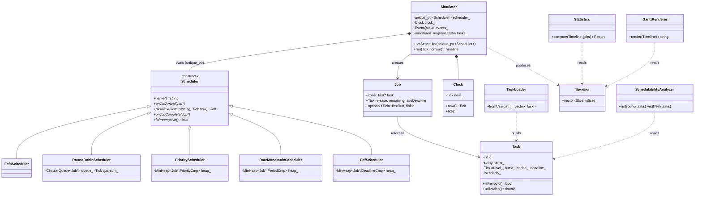

# Phase 1 — Design

This document is the blueprint for the RTOS Task Scheduler Simulator. Read it
top to bottom once; every later phase fills in one box of the class diagram.

## 1. Requirements

### Functional
| ID  | Requirement |
|-----|-------------|
| F1  | A task has: id, name, arrival time, burst (execution) time, priority, period (0 = aperiodic), relative deadline. |
| F2  | Tasks load from a CSV file and can also be created in code. |
| F3  | Time advances in discrete ticks (1 tick = 1 time unit). |
| F4  | Schedulers: FCFS, Round Robin (quantum q), Preemptive Priority, Rate Monotonic, EDF. Swappable at runtime. |
| F5  | Output: ASCII Gantt chart, per-task stats (waiting, turnaround, response, deadline misses), overall stats (CPU utilization, context switches, throughput). |
| F6  | Schedulability tests: Liu & Layland bound for RM, U ≤ 1 for EDF. |
| F7  | Comparison mode: same task set through every scheduler, one summary table. |

### Non-functional
- C++17, CMake ≥ 3.16, GoogleTest, builds warning-free with `-Wall -Wextra -Wpedantic`.
- No raw `new`/`delete`. Ownership is expressed with `std::unique_ptr`.
- Adding a scheduler must not modify `Simulator` (open/closed principle).
- Deterministic: same input always gives the same timeline (needed for tests).

### Assumptions (state these in interviews)
- Single core, so at most one task runs per tick.
- Context-switch cost is zero ticks, but we *count* switches.
- A periodic task with period P releases a new **job** every P ticks; each job has
  absolute deadline = release + relative deadline (defaults to P if not given).
- Ties are broken by lower task id, so results are deterministic.

## 2. Key idea: Task vs Job

A **Task** is the static description ("sensor read, every 10 ms, takes 2 ms").
A **Job** is one runtime instance of it ("the release at t = 30, 1 ms left, deadline 40").
Aperiodic tasks have exactly one job. Keeping these separate is what lets RM and
EDF work: the scheduler juggles jobs, the loader only knows about tasks.

FreeRTOS maps the same way: `xTaskCreate()` makes the task (TCB); each time a
periodic task wakes from `vTaskDelayUntil()` it is effectively a new job.

## 3. Class diagram



### Responsibilities (single responsibility principle)
| Class | One job | Why separate |
|-------|---------|--------------|
| `Task` | Hold validated, immutable task parameters | Data with invariants (burst > 0, etc.) |
| `Job` | Runtime state of one release | Keeps `Task` immutable and shareable |
| `TaskLoader` | Parse CSV into `Task`s | I/O changes (JSON later) never touch the engine |
| `Clock` | Own the current tick | One source of truth for time; easy to mock |
| `Scheduler` (abstract) | Decide *which* job runs next | Strategy pattern; the policy is the only thing that varies |
| `Simulator` | Drive the tick loop, release jobs, record what ran | Knows *when*, never *who* |
| `Timeline` | Record of (start, end, jobId) slices | Shared input for stats and rendering |
| `Statistics` | Turn a timeline into numbers | Pure function, trivial to unit test |
| `GanttRenderer` | Turn a timeline into ASCII | Swap for CSV exporter without touching stats |
| `SchedulabilityAnalyzer` | Offline math tests | Doesn't need a simulation at all |

## 4. The Scheduler interface (Strategy pattern)

```cpp
class Scheduler {
public:
    virtual ~Scheduler() = default;
    virtual std::string name() const = 0;
    virtual void onJobArrival(Job* job) = 0;              // job enters ready queue
    virtual Job* pickNext(Job* running, Tick now) = 0;     // who runs this tick?
    virtual void onJobComplete(Job* job) = 0;             // cleanup
    virtual bool isPreemptive() const = 0;
};
```

The simulator loop, per tick, is always:

1. Pop every event due at `now` from the event queue → call `onJobArrival`.
2. `next = scheduler->pickNext(running, now)`; if `next != running`, count a context switch.
3. Run `next` for one tick, append to the timeline.
4. If its `remaining == 0`, call `onJobComplete`, record finish time.
5. `clock.tick()`.

The simulator never says `if (algo == EDF)`. Adding "Least Laxity First" later
means one new class and zero edits to `Simulator`: that is open/closed.

## 5. Data structures and why

| Where | Structure | Built by | Reason |
|-------|-----------|----------|--------|
| FCFS ready queue | `std::queue<Job*>` | STL | Arrival order is all we need, O(1) push/pop |
| Round Robin ready queue | `CircularQueue<T>` (ring buffer) | **us** | Fixed capacity, no allocation per op, the same structure FreeRTOS uses for its queues |
| Priority / RM / EDF ready queue | `MinHeap<T, Compare>` (array-backed binary heap) | **us** | O(log n) insert and extract-min; one template, three comparators |
| Future releases | Event queue = `MinHeap<Event, ByTime>` | **us** (reuses heap) | Jump straight to the next release instead of scanning all tasks |
| Task lookup by id | `std::unordered_map<int, Task>` | STL | O(1) average lookup for stats and Gantt labels |
| Job storage | `std::vector<std::unique_ptr<Job>>` | STL | Owns jobs; schedulers hold non-owning `Job*` that never dangle |
| Input ordering | `std::stable_sort` by arrival | STL | O(n log n), stable keeps file order for ties |

Why our own heap instead of `std::priority_queue`? Two reasons you can say in an
interview: (1) we can explain and test every line, and (2) `std::priority_queue`
has no way to remove or re-key an arbitrary element, which Priority Inheritance
(stretch goal) needs. Our heap can expose that.

## 6. Complexity per scheduler operation (n = ready jobs)

| Scheduler | Arrival | pickNext | Complete | Notes |
|-----------|---------|----------|----------|-------|
| FCFS | O(1) | O(1) | O(1) | Non-preemptive |
| Round Robin | O(1) | O(1) | O(1) | Rotates when quantum expires |
| Preemptive Priority | O(log n) | O(log n) | O(log n) | Peek is O(1); swap in only if higher priority |
| Rate Monotonic | O(log n) | O(log n) | O(log n) | Priority = 1/period, fixed |
| EDF | O(log n) | O(log n) | O(log n) | Priority = absolute deadline, dynamic per job |

Whole simulation: O(H · log n) for H ticks. Space: O(T + J) for tasks and jobs.

## 7. Input format

`data/sample_tasks.csv`:

```
id,name,arrival,burst,priority,period,deadline
1,SensorRead,0,1,2,4,4
```

`period = 0` means aperiodic. `deadline = 0` means "use the period". Lower
`priority` number = higher priority (same convention as Linux RT and Zephyr;
FreeRTOS is the opposite, higher number wins, worth mentioning).

## 8. Folder layout

```
rtos-scheduler-simulator/
├── CMakeLists.txt          top-level build: library + app + tests
├── include/rtos/           public headers (one class per header)
├── src/                    .cpp implementations + main.cpp
├── tests/                  GoogleTest unit tests
├── data/                   sample task sets
└── docs/                   this design doc, diagrams
```

Headers live under `include/rtos/` so includes read `#include "rtos/Task.hpp"`.
That namespaced path avoids clashes if the library is ever used elsewhere.

The build makes three targets:
- `rtos_core`: a static library with all the logic.
- `rtos_sim`: the CLI, a thin `main.cpp` that links `rtos_core`.
- `rtos_tests`: GoogleTest binary that also links `rtos_core`.

Tests link the library, not the executable, so everything is testable without
parsing stdout. This is the standard "thin main" pattern.

## 9. Connection to real RTOSes

| This project | FreeRTOS | Zephyr |
|--------------|----------|--------|
| `Task` | TCB (`TCB_t`) created by `xTaskCreate` | `struct k_thread`, `k_thread_create` |
| Tick-based `Clock` | `xTickCount`, `configTICK_RATE_HZ` | `sys_clock` ticks, `CONFIG_SYS_CLOCK_TICKS_PER_SEC` |
| Preemptive Priority | Default scheduler (`configUSE_PREEMPTION 1`) | Preemptive threads (negative priority = cooperative) |
| Round Robin among equals | `configUSE_TIME_SLICING` | `CONFIG_TIMESLICING` |
| EDF | Not built in | `CONFIG_SCHED_DEADLINE`, `k_thread_deadline_set` |
| Ready queue | Array of linked lists, one per priority, plus a bitmap | Configurable: dumb list, red-black tree, or multi-queue |
| Priority Inheritance | Mutexes (`xSemaphoreCreateMutex`) | `k_mutex` |

Interesting contrast: FreeRTOS uses one list per priority level, so pickNext is
O(1) with a bitmap "find highest set bit" instruction. We use a heap, which is
O(log n) but supports an unbounded range of priorities and dynamic keys (EDF).

## 10. Phase 1 interview questions

1. **Why separate Task and Job?**
   A task is the static spec; a job is one release with its own remaining time
   and deadline. Periodic scheduling (RM, EDF) works on jobs, and keeping `Task`
   immutable means it can be shared safely.
2. **Why is `Scheduler` an abstract class, and where's the Strategy pattern?**
   The simulator holds a `unique_ptr<Scheduler>` and calls virtual methods. Each
   algorithm is a concrete strategy. New algorithms are added without editing
   the simulator (open/closed), and the algorithm can be swapped at runtime.
3. **Why `unique_ptr` for the scheduler but raw `Job*` in queues?**
   `unique_ptr` expresses ownership. The queues only *observe* jobs that the
   simulator owns in a vector, so a non-owning raw pointer is correct and
   cheap; using `shared_ptr` there would hide who owns what and add refcounting.
4. **Why build your own heap when the STL has `priority_queue`?**
   To understand and test it, and because we need operations it lacks (remove or
   re-key an element) for priority inheritance later.
5. **Why put the logic in a library instead of the executable?**
   So unit tests link the same code the CLI uses, with no duplicated sources
   and no testing via stdout.
